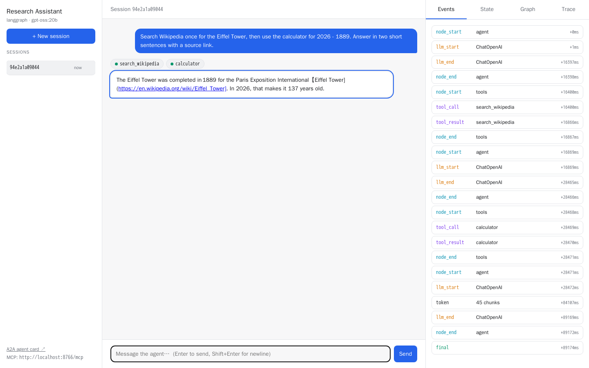

# Nadini

**ناديني — make your agent callable from anywhere: A2A · MCP · UI**

Nadini is an interactive [Copier](https://copier.readthedocs.io) template for AI agent services. You write the agent logic in `agent/`. Nadini generates everything around it: the protocols, a dev UI, telemetry, Docker and CI.

```
            ┌──────────────── your agent (agent/) ────────────────┐
 A2A  ──►   │                                                      │
 MCP  ──►   │  agent/main.py  ─►  LangGraph / LangChain  ─►  LLM   │ ─► OTLP ─► Grafana
 Dev UI ─►  │   message / stream_events        tools, memory       │ ─► Langfuse
            └──────────────────────────────────────────────────────┘
```

All three entry points (A2A, MCP, dev UI) call **one** function contract in `agent/main.py`, so they always behave the same.

📖 **[Usage guide](docs/GUIDE.md)** · 🧪 **[Worked example: Research Assistant](docs/EXAMPLE.md)**

- [Features](#features)
- [Quick start](#quick-start)
- [Generation questions](#generation-questions)
- [What you get](#what-you-get)
- [Run, call and observe](#run-call-and-observe)
- [Build, publish and deploy](#build-publish-and-deploy)
- [Keep it up to date](#keep-it-up-to-date)
- [Troubleshooting](#troubleshooting)
- [Developing the template](#developing-the-template)
- [Why the name](#why-the-name)

## Features

- **A2A** endpoint: official `a2a-sdk`, spec 1.0 with 0.3 compatibility, streaming, agent card
- **MCP** endpoint: official `mcp` SDK, streamable HTTP, one `message` tool with conversation memory
- **LangGraph or LangChain**, chosen at generation time (explicit `StateGraph` or `create_agent`)
- **Any OpenAI-compatible model**: OpenAI, Ollama, vLLM, LiteLLM, Azure OpenAI, via `OPENAI_BASE_URL`
- **Conversation memory** keyed by A2A `contextId` / MCP `context_id`: in-memory or PostgreSQL
- **Dev chat UI** in the style of Google ADK's `adk web`: sessions, event timeline, state, graph, trace links
- **OpenTelemetry** traces, metrics and logs to Grafana (Tempo/Loki/Mimir via Alloy or LGTM), plus optional **Langfuse** on the same pipeline
- **Optional bearer-token auth** on A2A, MCP and the dev API
- **Dockerfile** (multi-stage, uv, non-root, healthcheck) and a compose stack with Grafana LGTM (and Postgres)
- **Configurable bind address**: `127.0.0.1` (this machine only) or `0.0.0.0` (the network)
- **GitHub Actions** (optional): lint + test + docker build, or a multi-arch (amd64 + arm64) image pushed to **Docker Hub**, built on the GitHub runner or on Docker Build Cloud
- **Tests with a fake LLM** for the agent, A2A, MCP and the dev UI, so CI needs no API key
- **No hardcoded versions**: dependencies are added by name, resolved to the latest releases at generation time, and locked in `uv.lock`

## Quick start

Prerequisites: [uv](https://docs.astral.sh/uv/), Docker (optional, for images and the Grafana stack), and an OpenAI API key or any OpenAI-compatible endpoint. Generation needs network access, because dependency versions are resolved then.

```bash
uvx copier copy --trust gh:<you>/nadini my-agent   # answer the questions
cd my-agent
cp .env.example .env                                # set OPENAI_API_KEY and LLM_MODEL
make dev                                            # → http://localhost:8000/dev-ui
```

`--trust` lets the template run its post-generation tasks (`uv add …` and `git init`).

Non-interactive, for scripts and CI:

```bash
uvx copier copy --trust --defaults gh:<you>/nadini my-agent \
  -d project_name="Support Bot" -d framework=langchain -d bind_host=0.0.0.0 \
  -d ci=dockerhub -d dockerhub_image=me/support-bot
# or keep the answers in a file:
uvx copier copy --trust --data-file answers.yml gh:<you>/nadini my-agent
```

## Generation questions

| Question | Choices | Effect |
| --- | --- | --- |
| `project_name` | free text | Agent name in the A2A card, MCP server info and traces |
| `project_slug` | derived | Package, image and service name |
| `description` | free text | Agent card / MCP tool description and system prompt |
| `framework` | `langgraph` / `langchain` | `agent/graph.py` (explicit `StateGraph`) or `agent/chain.py` (`create_agent`) |
| `checkpointer` | `memory` / `postgres` | Conversation memory backend. `postgres` adds a Postgres service to compose |
| `enable_langfuse` | yes / no | Adds the `langfuse` SDK, attached to the same OTel pipeline |
| `enable_devui` | yes / no | Adds the chat UI at `/dev-ui` |
| `enable_auth` | yes / no | Sets `AUTH_TOKEN` in `.env.example` (the bearer middleware is always present) |
| `python_version` | e.g. `3.14` | `requires-python`, `.python-version` and the Docker base image |
| `port` | e.g. `8000` | Listening port |
| `bind_host` | `127.0.0.1` / `0.0.0.0` | Address `make dev` / `make run` listen on, and the address compose publishes ports on. The container itself always listens on `0.0.0.0` |
| `ci` | `none` / `test` / `dockerhub` | No workflow; lint + test + docker build; or lint + test + multi-arch build pushed to Docker Hub |
| `dockerhub_image` | e.g. `me/my-agent` | Docker Hub repository (asked when `ci=dockerhub`) |
| `docker_builder` | `runner` / `cloud` | Build on the GitHub runner (QEMU) or on Docker Build Cloud (asked when `ci=dockerhub`) |
| `build_cloud_builder` | e.g. `myorg/default` | Docker Build Cloud builder (asked when `docker_builder=cloud`) |
| `author_name`, `author_email` | free text | `authors` in `pyproject.toml` |
| `install_deps` | yes / no | Run `uv add` now. If no, run `make deps` later |

## What you get

```
my-agent/
├── agent/                  ← YOUR CODE
│   ├── main.py             the contract: message() / stream_events() — keep the signatures
│   ├── graph.py | chain.py the agent itself (LangGraph or LangChain)
│   ├── tools.py            tools; append to TOOLS
│   ├── prompts.py          system prompt
│   ├── llm.py              chat-model factory
│   ├── memory.py           checkpointer (memory / postgres)
│   ├── events.py           astream_events → stable AgentEvent schema
│   └── settings.py         agent env config
├── server/                 ← PLUMBING (rarely touched)
│   ├── app.py              Starlette app, routes, lifespan
│   ├── a2a_app.py          A2A executor + agent card
│   ├── mcp_app.py          MCP server + `message` tool
│   ├── devui/              dev chat UI + /dev/api
│   ├── telemetry.py        OTel traces/metrics/logs, Langfuse
│   ├── auth.py             bearer-token middleware
│   └── config.py           server env config
├── tests/                  fake-LLM tests
├── scripts/deps.sh         dependency names (no versions)
├── .github/workflows/      ci.yml (when ci ≠ none)
└── Dockerfile  compose.yaml  Makefile  .env.example  uv.lock
```

Endpoints:

| Path | What |
| --- | --- |
| `/` | A2A JSON-RPC (`SendMessage`, `SendStreamingMessage`, …) |
| `/.well-known/agent-card.json` | A2A agent card |
| `/mcp` | MCP streamable HTTP |
| `/dev-ui`, `/dev/api` | Dev chat UI and its API (only when `DEV_UI_ENABLED=true`) |
| `/healthz`, `/readyz` | Liveness and readiness probes |

Make targets:

| Target | What |
| --- | --- |
| `make dev` | Run with auto-reload and the dev UI |
| `make run` | Run like production |
| `make test` / `make lint` / `make fmt` | pytest / ruff check + format check / auto-fix |
| `make build` | Build the Docker image |
| `make up` / `make down` | Start / stop the agent + Grafana LGTM (+ Postgres) with compose |
| `make deps` / `make upgrade` | Resolve dependencies by name / bump everything to the latest release |

## Run, call and observe

**Dev UI.** Run `make dev`, then open `http://localhost:8000/dev-ui`. Sessions are on the left and the streamed chat, with tool-call chips, is in the middle. The inspector on the right shows the event timeline, checkpointed state, a Mermaid graph and trace links.



**A2A:**

```bash
curl -s localhost:8000/.well-known/agent-card.json
curl -s localhost:8000/ -H 'Content-Type: application/json' -H 'A2A-Version: 1.0' -d '{
  "jsonrpc": "2.0", "id": 1, "method": "SendMessage",
  "params": {"message": {"messageId": "m1", "role": "ROLE_USER", "contextId": "demo",
             "parts": [{"text": "What time is it in Tokyo?"}]}}
}'
```

**MCP** (Claude Code, VS Code, Cursor, MCP Inspector, or any MCP client):

```bash
claude mcp add --transport http my-agent http://localhost:8000/mcp
```

The `message(text, context_id)` tool returns `{"response", "context_id"}`. Pass the `context_id` back to continue the conversation.

**Observability.** `make up` starts Grafana LGTM at `http://localhost:3000`, and the agent sends traces, metrics and logs to it over OTLP. With `enable_langfuse`, set the `LANGFUSE_*` keys and the same traces appear in Langfuse, grouped by session. Set `OPENINFERENCE_HIDE_INPUTS=true` and `OPENINFERENCE_HIDE_OUTPUTS=true` to keep prompts and responses out of spans.

More in the guide: [calling the agent](docs/GUIDE.md#6-call-the-agent) (streaming, Python clients, other agents) and [observability](docs/GUIDE.md#7-observability).

## Build, publish and deploy

```bash
make build
docker run --env-file .env -p 127.0.0.1:8000:8000 my-agent:latest   # drop "127.0.0.1:" to expose it on the network
```

The image is built with `uv sync --locked`, runs as a non-root user, has a `HEALTHCHECK` on `/healthz`, keeps the dev UI off, and shuts down gracefully.

**Docker Hub from CI** (`ci=dockerhub`): the generated workflow runs lint + tests, then builds `linux/amd64` + `linux/arm64` and pushes to `dockerhub_image`.

| Trigger | Tags pushed |
| --- | --- |
| push to `main` | `latest`, `sha-<short sha>` |
| tag `v1.2.3` | `1.2.3`, `1.2` |
| pull request | none (build only) |

Add the repository secrets `DOCKERHUB_USERNAME` and `DOCKERHUB_TOKEN` (a Docker Hub access token with Read & Write scope). `docker_builder` picks where the image is built:

- `runner`: buildx + QEMU on the GitHub runner, cached in the GitHub Actions cache. Free, but arm64 builds are slow.
- `cloud`: [Docker Build Cloud](https://docs.docker.com/build-cloud/), with native amd64 and arm64 builders. Give the builder as `build_cloud_builder` (`ORG/NAME`). Pull requests from forks get no secrets, so they can't build there.

**In production**, set `PUBLIC_URL` (advertised in the agent card), `AUTH_TOKEN` or an auth gateway, `MCP_ALLOWED_HOSTS` and `OTEL_EXPORTER_OTLP_ENDPOINT`. Use `checkpointer=postgres` if you run more than one replica. Kubernetes probes, scaling notes and every environment variable are in the guide: [build and deploy](docs/GUIDE.md#8-build-and-deploy) and the [configuration reference](docs/GUIDE.md#configuration-reference).

## Keep it up to date

| Command | Effect |
| --- | --- |
| `make upgrade` | Bump every dependency to its latest release, then run `make test` |
| `make deps` | Re-resolve from the name list in `scripts/deps.sh` |
| `uvx copier update --trust` | Pull template improvements into your project. It's a 3-way merge, so your `agent/` changes are kept. Commit your project first |

## Troubleshooting

| Symptom | Fix |
| --- | --- |
| `LLM_MODEL is not set` | Add `LLM_MODEL=...` to `.env` |
| A2A error `-32009 ... version '0.3' is not supported` | Send `A2A-Version: 1.0` with 1.0 methods, or use the 0.3 names (`message/send`) |
| MCP `421 Invalid Host header` | Add the Host you call with to `MCP_ALLOWED_HOSTS`, or leave it empty |
| `401 unauthorized` | `AUTH_TOKEN` is set; send `Authorization: Bearer <token>` |
| Can't reach the agent from another machine | It was generated with `bind_host=127.0.0.1`. Change `--host` in the `Makefile` and the port mappings in `compose.yaml`, or regenerate with `0.0.0.0` |
| `/dev-ui` is 404 | Set `DEV_UI_ENABLED=true` (and generate with `enable_devui`) |
| Docker Hub push fails with `unauthorized` | Check the `DOCKERHUB_USERNAME` / `DOCKERHUB_TOKEN` secrets and that the token has write scope |

The full table is in the [guide](docs/GUIDE.md#10-troubleshooting).

## Developing the template

```
copier.yml            questions + post-generation tasks
template/             the project skeleton (rendered with Jinja)
docs/                 GUIDE.md, EXAMPLE.md, screenshots
examples/             research-assistant (generated + customised) and its answers file
.github/workflows/    template CI
```

Render a variant and test it:

```bash
uvx copier copy --trust --defaults --vcs-ref HEAD . /tmp/agent \
  -d framework=langchain -d checkpointer=postgres -d ci=dockerhub -d dockerhub_image=me/agent
cd /tmp/agent && uv run ruff check . && uv run pytest -q
uvx --from actionlint-py actionlint .github/workflows/ci.yml
```

The template CI renders four variants on pushes to `main`, on pull requests and **weekly** against the latest SDK releases. Between them they cover both frameworks, both checkpointers, auth on and off, both bind addresses and every CI option. Each variant is linted, tested and built with Docker, and generated workflows are checked with `actionlint`. The committed example is tested too.

`copier copy` uses the latest git tag of a template repo (or `HEAD` with `--vcs-ref HEAD`). Commit, and tag releases, so generated projects can `copier update`.

## Why the name

**Nadini** (ناديني) is Palestinian Arabic for **"call me"**. It comes from *nāda* (نادى), to call out to someone.

That is the template's whole job: making your agent *callable*.

- Other agents call it over **A2A**.
- Assistants and tools call it over **MCP**.
- You call it from the **dev UI**.

One agent answers on every line.

---

**Free Palestine** 🇵🇸
