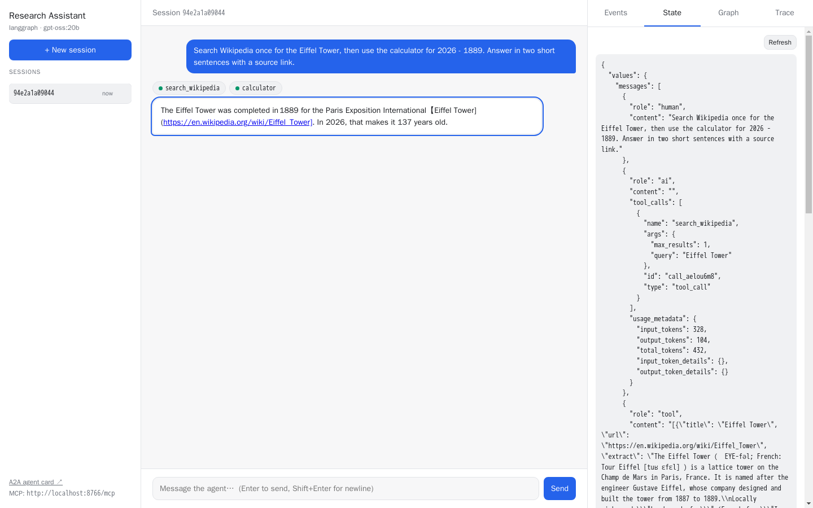
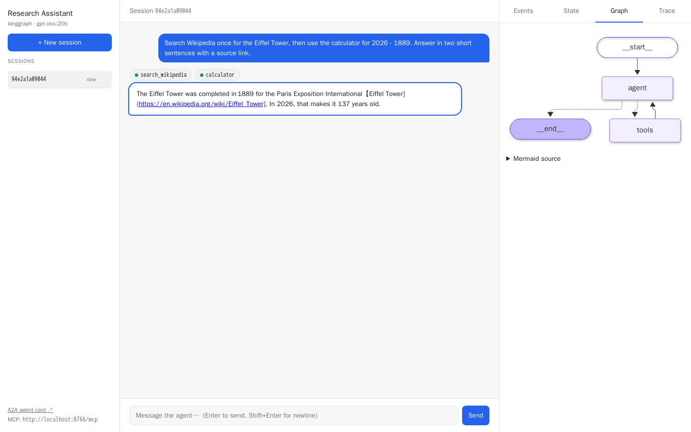
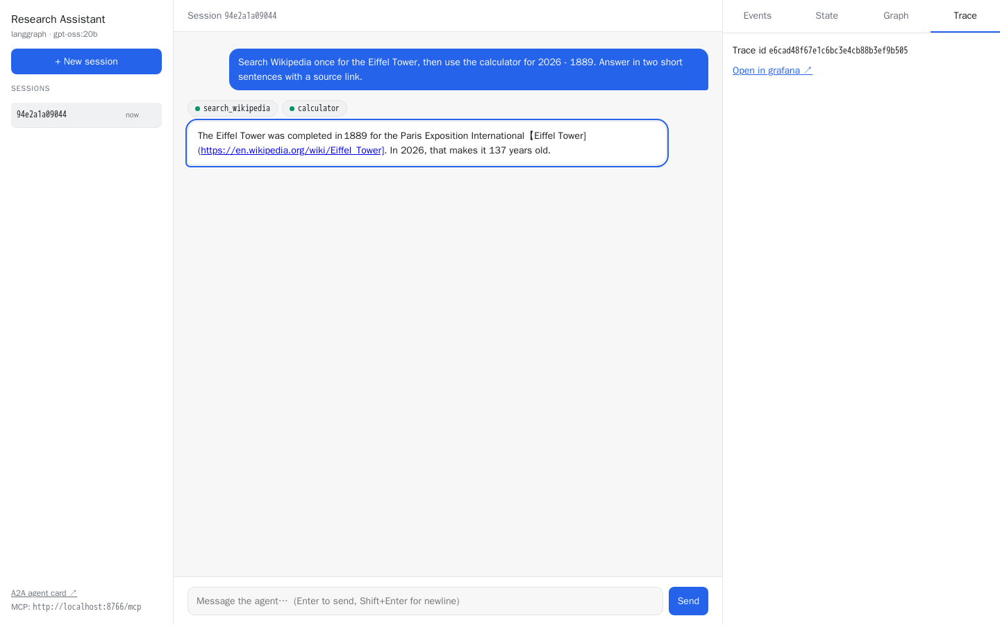

# Worked Example: Research Assistant

[`examples/research-assistant/`](../examples/research-assistant) is a real project generated from Nadini and then customised. It answers factual questions by searching **Wikipedia** (no API key needed) and doing exact arithmetic with a safe **calculator**, and it cites its sources.

The walkthrough below covers all of it: generation, customisation, the dev UI, A2A, MCP, traces and tests. Outputs shown are from real runs (model: `gpt-oss:20b` via a local Ollama). Your text will differ by model.

---

## 1. Generate the bare project

The answers live in [`examples/research-assistant.answers.yml`](../examples/research-assistant.answers.yml):

```yaml
project_name: Research Assistant
description: Answers questions by searching Wikipedia and doing exact arithmetic, citing its sources.
framework: langgraph
checkpointer: memory
enable_langfuse: true
enable_devui: true
```

```bash
uvx copier copy --trust --data-file examples/research-assistant.answers.yml . examples/research-assistant
```

Copier renders the files, then `scripts/deps.py` runs `uv add` for every dependency **by name**. The latest versions get locked, e.g.:

```toml
dependencies = [
    "a2a-sdk[http-server]>=1.2.2",
    "langgraph>=1.2.14",
    "mcp>=2.3.0",
    "langfuse>=4.17.0",
    ...
]
```

At this point the project already works. It's a chat agent with one tool (`get_current_time`).

## 2. Customise it

Only files in `agent/` change, plus one dependency. Nothing in `server/` is touched.

### 2a. Tools: `agent/tools.py`

```python
@tool
async def search_wikipedia(query: str, max_results: int = 3) -> list[dict]:
    """Search English Wikipedia. Returns title, url and a plain-text extract per page."""
    ...  # httpx call to the MediaWiki API

@tool
def calculator(expression: str) -> str:
    """Evaluate an arithmetic expression exactly, e.g. '(1969 - 1903) * 12'."""
    ...  # AST walk: only numbers and + - * / // % ** — no eval()

TOOLS = [search_wikipedia, calculator, get_current_time]
```

Then add the HTTP client:

```bash
uv add httpx
```

### 2b. Prompt: `agent/prompts.py`

```python
SYSTEM_PROMPT = """\
You are Research Assistant. ...
- Search Wikipedia before answering factual questions; do not rely on memory.
- Use the calculator for ANY arithmetic, including date differences.
- Cite sources as markdown links to the Wikipedia pages you used.
"""
```

### 2c. Graph: a tool budget (`agent/graph.py`)

This shows the LangGraph customisation pattern: **custom state, a custom router, and a node that reads both**. The agent may do at most `MAX_TOOL_ROUNDS` rounds of tool calls per question. After that it must answer with what it has.

```python
MAX_TOOL_ROUNDS = 4

class State(MessagesState):
    tool_rounds: int                         # visible in the dev UI "State" tab

async def call_model(state: State, config):
    rounds = state.get("tool_rounds", 0)
    if rounds >= MAX_TOOL_ROUNDS:            # budget spent → answer without tools
        response = await base_model.ainvoke(messages, config)
        # drop stray tool calls (some models emit them even unbound) so the turn ends
        return {"messages": [AIMessage(content=response.text, id=response.id)], "tool_rounds": 0}
    response = await model.ainvoke(messages, config)
    return {"messages": [response], "tool_rounds": rounds + 1 if response.tool_calls else 0}

graph.add_conditional_edges("agent", route)  # was: tools_condition
```

### 2d. Tests: `tests/test_tools.py`

These use the template's fake LLM (`script_llm`), so they need no API key and no network:

- calculator results, and rejection of `__import__`, `1/0` and huge powers
- Wikipedia result parsing, against a mocked `httpx` transport
- the budget guard: script a model that calls tools forever, and keeps emitting a tool call even in its forced answer. Assert the turn still stops after `MAX_TOOL_ROUNDS`. (This exact loop showed up with a real local model while building the example.)

```bash
$ make test
......................                                                   [100%]
22 passed in 1.17s
```

## 3. Run it

```bash
cd examples/research-assistant
cp .env.example .env
# OpenAI:  OPENAI_API_KEY=sk-...  LLM_MODEL=gpt-5-mini
# or Ollama (local, free):
#   OPENAI_API_KEY=ollama  OPENAI_BASE_URL=http://localhost:11434/v1  LLM_MODEL=gpt-oss:20b
make dev
```

## 4. Chat in the dev UI

Open http://localhost:8000/dev-ui and ask:

> Search Wikipedia once for the Eiffel Tower, then use the calculator for 2026 - 1889. Answer in two short sentences with a source link.


- **Chat:** chips for `search_wikipedia` and `calculator` appear and turn green as each tool finishes. Then the answer streams in, with links.
- **Events:** `node_start agent → llm_start → llm_end (tool_calls) → node_start tools → tool_call search_wikipedia {"query": …} → tool_result […] → … → final`, with ms offsets. Click any row to see its JSON.
- **State:** the checkpoint, including `tool_rounds` and every message.
- **Graph:** the compiled graph (`agent → tools → agent`, plus the custom `route`).
- **Trace:** the trace id, with links into Grafana Tempo and Langfuse.

| State | Graph | Trace |
| --- | --- | --- |
|  |  |  |

## 5. Ask the same thing over A2A

```bash
curl -s localhost:8000/ -H 'Content-Type: application/json' -H 'A2A-Version: 1.0' -d '{
  "jsonrpc": "2.0", "id": 1, "method": "SendMessage",
  "params": {"message": {"messageId": "m1", "role": "ROLE_USER", "contextId": "apollo",
             "parts": [{"text": "How many years passed between the Wright brothers first flight and the Apollo 11 Moon landing?"}]}}
}' | jq '.result.task | {state: .status.state, history: [.history[].parts[].text], answer: .artifacts[0].parts[0].text}'
```

Real response, abridged:

```json
{
  "state": "TASK_STATE_COMPLETED",
  "history": [
    "How many years passed between the Wright brothers first flight and the Apollo 11 Moon landing?",
    "Calling tool `search_wikipedia`",
    "Finished tool `search_wikipedia`",
    "Calling tool `search_wikipedia`",
    "Finished tool `search_wikipedia`"
  ],
  "answer": "The first controlled, sustained flight by the Wright brothers occurred on **December 17, 1903** ... Apollo 11 touched down on the Moon on **July 20, 1969** ... So **about 65 years, 7 months** passed ..."
}
```

Because `contextId` is `"apollo"`, a follow-up such as *"And how many days is that?"* in the same context continues the conversation. The session also shows up in the dev UI's session list.

## 6. And over MCP

```bash
claude mcp add --transport http research http://localhost:8000/mcp
```

From Claude Code you can now say *"ask the research agent who designed the Eiffel Tower"*. Claude calls the `message` tool and gets back `{"response": ..., "context_id": ...}`.

Or from Python:

```python
from mcp import Client

async with Client("http://localhost:8000/mcp") as client:
    r = await client.call_tool("message", {"text": "Who designed the Eiffel Tower?", "context_id": "eiffel"})
    print(r.structured_content["response"])
```

## 7. See the trace in Grafana

```bash
make up                    # agent + grafana/otel-lgtm
open http://localhost:3000 # Explore → Tempo → search service.name = research-assistant
```

A real trace for *"What is 12*12? Use the calculator."*, as exported to Tempo:

```
POST /dev/api/run_sse                       (HTTP server span)
└─ dev_ui.turn                              session.id=trace-check-2
   └─ Research Assistant          CHAIN     session.id=trace-check-2
      ├─ agent                    AGENT
      │  └─ ChatOpenAI            LLM       model, prompts, tool_calls, token counts
      ├─ route                    CHAIN
      ├─ tools                    CHAIN
      │  └─ calculator            TOOL      input {"expression": "12*12"} → "144"
      ├─ agent                    AGENT
      │  └─ ChatOpenAI            LLM
      └─ route                    CHAIN
```

Logs from the same request land in Loki with the same `trace_id`, so you can jump from a log line to its trace. HTTP metrics (`http_server_duration_*`) land in Prometheus.

With Langfuse keys set, Langfuse receives the OpenInference spans of this trace (agent, LLM, tool) from the same TracerProvider. That means the **same trace id** as in Tempo, and `session.id` lets Langfuse group the trace under session `trace-check-2`.

## 8. Ship it

```bash
make build
docker run --env-file .env -e DEV_UI_ENABLED=false -p 8000:8000 research-assistant:latest
```
